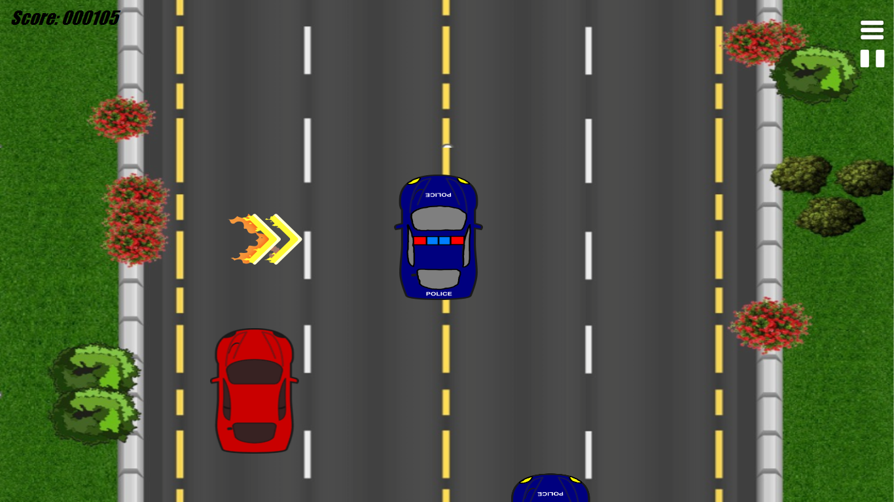
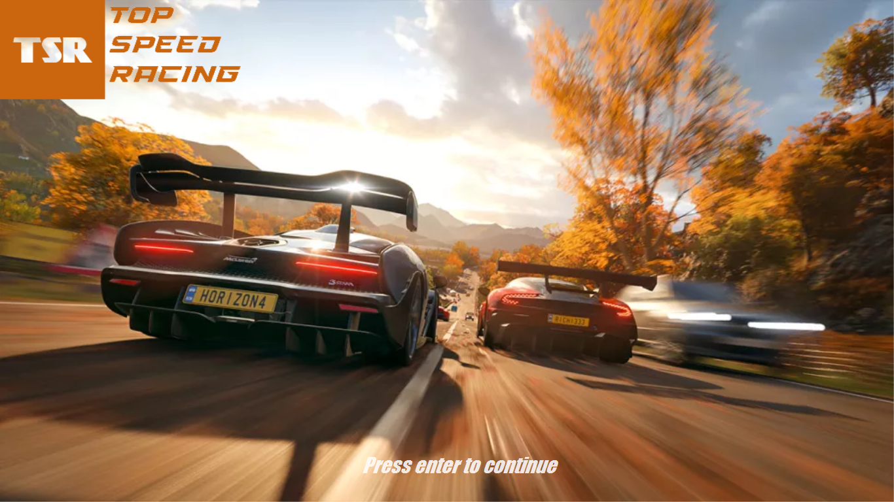
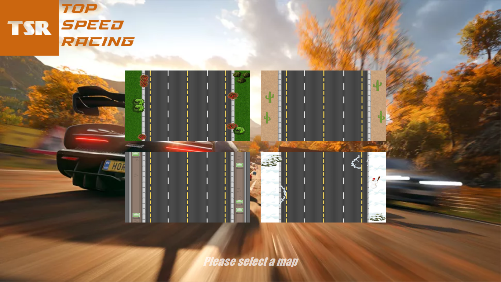
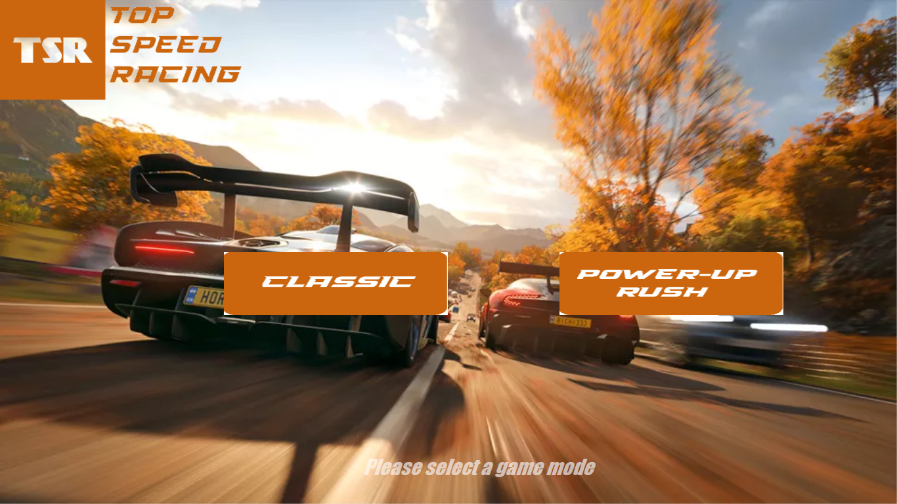
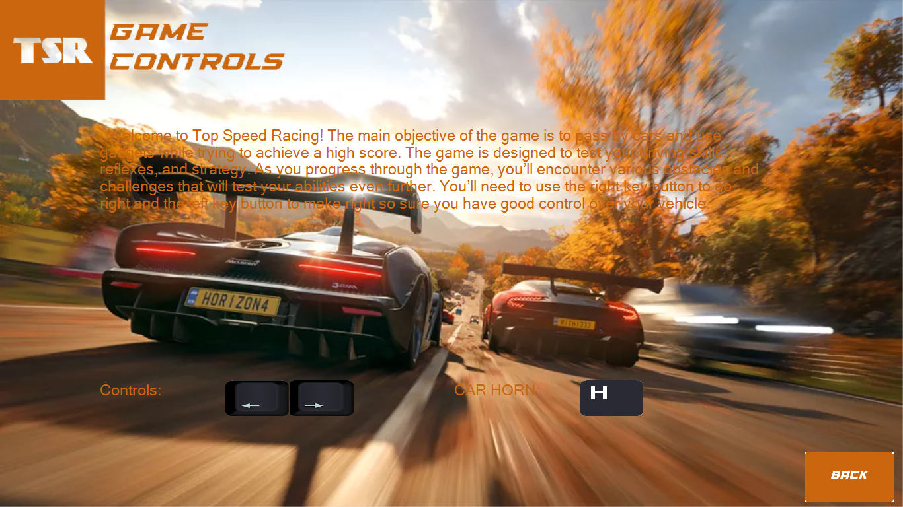
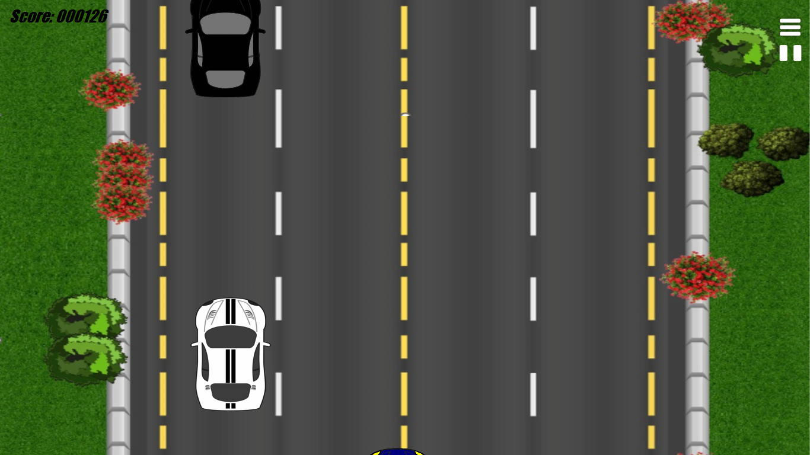
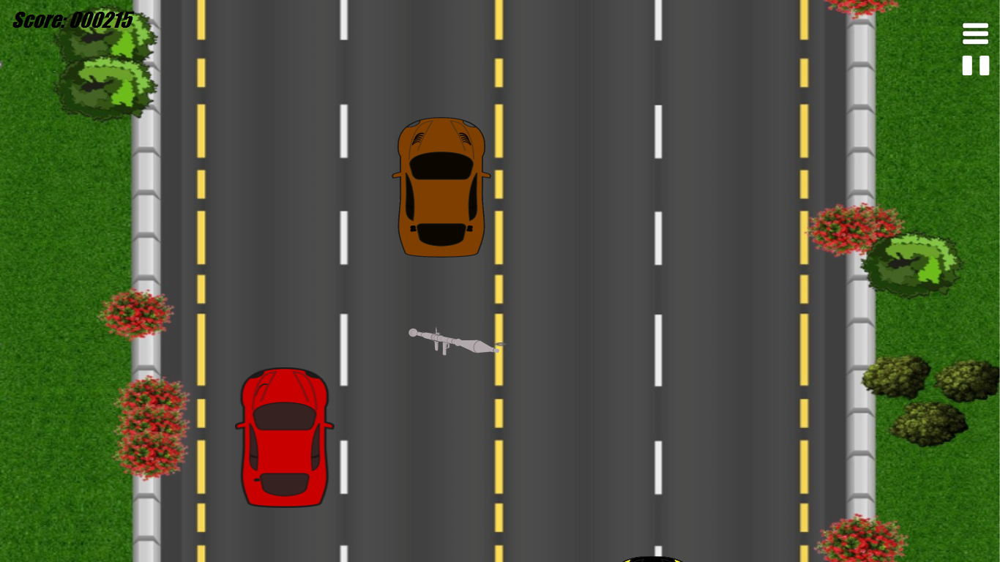
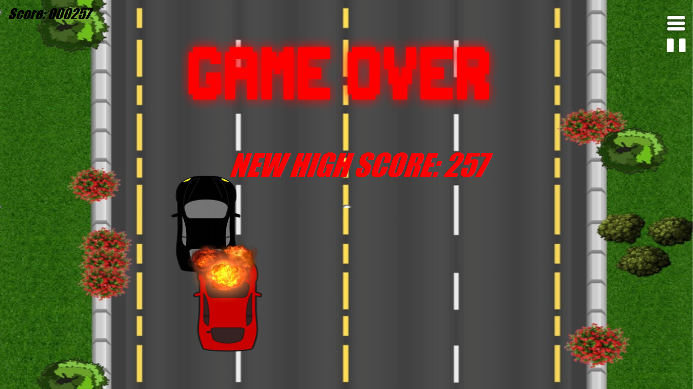
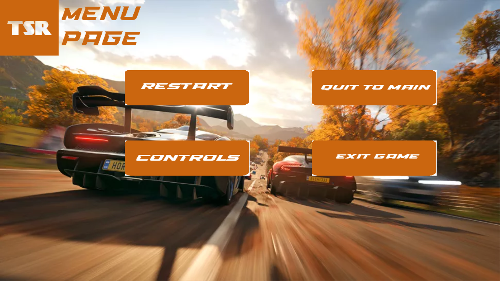

# Top Speed Racing (TSR)

**Top Speed Racing** is a 2D arcade racing game I developed as a personal project using **C# and Windows Forms**. Pick one of four road environments, choose a game mode, steer through traffic, avoid collisions and try to beat your high score. The game includes interactive menus, sounds, power-ups and live score tracking.

**Platform:** Windows (x64 player build) · **Language:** C# · **Framework:** .NET 6 / Windows Forms

## 🎮 Gameplay demo

[](media/gameplay-demo.mp4)

**[▶ Watch the gameplay demo (MP4, ~41 seconds)](media/gameplay-demo.mp4)**

This short demo shows driving, oncoming traffic, power-ups and the game-over screen. Click the image or link to open the actual recorded gameplay; GitHub may show the MP4 on a separate page rather than as an inline player in the README.

## ⬇️ Download and play on Windows

### Play directly from this repository (no coding required)

**The compiled Windows game is included in [`Play-Windows/`](Play-Windows/).** To play:

1. On the GitHub repository page click **Code → Download ZIP** (download the **whole repository**, not just `TopSpeedRacing.exe`).
2. Extract the ZIP to a normal Windows folder.
3. Open `top-speed-racing/Play-Windows/`.
4. Double-click **`TopSpeedRacing.exe`**.
5. Press **Enter**, select your map and game mode, and play.

The executable is a **self-contained Windows x64 build**; it comes with the .NET runtime, graphics, sounds, and supporting DLLs, so players normally don't need Visual Studio or a separate .NET installation. **Do not move or download the EXE alone:** it needs the other files in `Play-Windows/`. Windows may show a SmartScreen warning because this app is not code-signed.

**Optional lighter download:** [GitHub Releases](https://github.com/ahmadmnsourr/top-speed-racing/releases) can also host the playable ZIP as a release asset. A published GitHub Release is not required to use the `Play-Windows/` folder included here.

> **Build status:** This self-contained executable was built and launched successfully on the developer's Windows PC. Compatibility on other Windows computers has not yet been independently tested.

## ✨ Game features

- **Classic Mode** — avoid traffic, survive and build your score.
- **Power-Up Rush** — play with nitro, shield and weapon pickups.
- **Four maps** — Field, Desert, Highway and Snow.
- **Dynamic traffic and collision detection** — react to vehicles and obstacles.
- **Game interfaces** — welcome screen, map/mode selection, pause menu, game-over screen and controls guide.
- **Sound effects and music** — audio cues for gameplay, power-ups and menus.
- **Scoring system** — in-game score display and high-score tracking (see known issue below).

## 🕹️ Controls

| Control | Action |
|---|---|
| `Enter` | Continue from the title screen |
| `←` / `→` | Steer left / right |
| `H` | Horn |
| On-screen buttons | Select map/mode, pause, resume, restart, return to menu and exit |

## 📸 Screenshots

### Game selection and menus

| Title screen | Choose a map |
|---|---|
|  |  |

| Choose a mode | Controls |
|---|---|
|  |  |

### Gameplay

| Classic gameplay | Traffic and overtaking |
|---|---|
|  |  |

| Power-up gameplay | Game over and high score |
|---|---|
|  |  |



[View the longer edited screen recording](media/full-recording-edited.mp4) (includes menus).

## 🛠️ Build from source

For developers who want to inspect or modify the code:

**Requirements:** Windows, Visual Studio with the **.NET desktop development** workload or the .NET SDK, and the dependencies needed to build the project's `net6.0-windows` target. The project originated on .NET 6, which is now out of support; moving to a supported target framework is a potential future improvement.

1. Clone or download this repository.
2. Open `TSR.sln` in Visual Studio and run with **F5**, or open a terminal in the repository root and run:

```powershell
dotnet run --project TSR/TSR.csproj
```

To publish a self-contained Windows x64 build from the repository root:

```powershell
dotnet publish TSR/TSR.csproj -c Release -r win-x64 --self-contained true -o release
```

This produces `release/TopSpeedRacing.exe` plus the runtime, `Images/`, `Audios/`, and other necessary files. Distribute the **entire folder** as a ZIP, not just the executable. The compiled, playable Windows build is already included in this repository under `Play-Windows/`. For future builds, replace that entire folder with the contents of a fresh publish output. You can additionally attach a ZIP to a **GitHub Release** for a smaller, easier player download.

## 📁 Project structure

```text
top-speed-racing/
├── TSR.sln                # Visual Studio solution
├── TSR/
│   ├── TSR.csproj          # C# game settings; TopSpeedRacing output name
│   ├── Program.cs                   # Application entry point
│   ├── LoadingScreen.cs             # Welcome screen
│   ├── Map.cs / Mode.cs             # Map and game-mode selection
│   ├── ClassicGame.cs / Game.cs     # Two gameplay modes
│   ├── Menu.cs / About.cs / Var.cs  # Menus, controls and shared state
│   ├── *.Designer.cs / *.resx       # Windows Forms designer and resources
│   ├── Images/                      # 41 runtime graphics
│   ├── Audios/                      # 8 runtime sound files
│   └── HighScore.txt                # Default score file
├── screenshots/                     # 9 screenshots used in this README
├── media/
│   ├── gameplay-demo.mp4            # Edited ~41 s gameplay preview
│   └── full-recording-edited.mp4    # Longer edited recording
├── Play-Windows/                    # Compiled, self-contained Windows x64 build
│   ├── TopSpeedRacing.exe           # Run this after downloading/extracting the repo
│   ├── Images/ and Audios/          # Runtime game assets
│   └── *.dll and other files        # Required runtime dependencies
├── ASSET_PROVENANCE.md              # Asset credits / rights notes
├── RELEASE_NOTES.md                 # Notes for v1.0.0 GitHub Release
├── .gitignore
└── README.md
```

The project file copies the `Images/`, `Audios/`, and `HighScore.txt` files to the output folder during build.

## ⚠️ Known limitations

- This is a **Windows desktop game**, not a web game, and not an autonomous-driving simulation.
- The game uses relative resource paths: keep the executable with its runtime media folders.
- The current game code may **reset the saved high score on exit**; that is a known issue for future improvement.
- The creator successfully built the project on Windows (with nonfatal compiler warnings) and launched the game; an independent clean-machine test remains to be done.

## Attribution and licensing

This was developed as a personal programming project. Some images, audio and other media were downloaded from sources the developer recalls as **free to use**, but the specific sites, licenses, and credit requirements are not currently recorded. The packaged media, screenshots and videos are included to demonstrate the project; their underlying third-party rights have not been independently verified. See [ASSET_PROVENANCE.md](ASSET_PROVENANCE.md).

No blanket open-source license is asserted for all files. Any applicable credits, license notices or required permissions for third-party assets should be preserved when identified.

## 📤 Uploading this full repository to GitHub

Because this version includes the whole compiled Windows runtime (hundreds of files), **use GitHub Desktop or command-line Git to commit/push the extracted folder**. GitHub's web uploader accepts only 100 files per batch and 25 MiB per file; you should not drag the entire outer ZIP into the web upload page. The `Play-Windows/` files are intentionally tracked. Avoid committing future `release/`, `publish/`, `bin/` or `obj/` outputs outside that curated folder.
